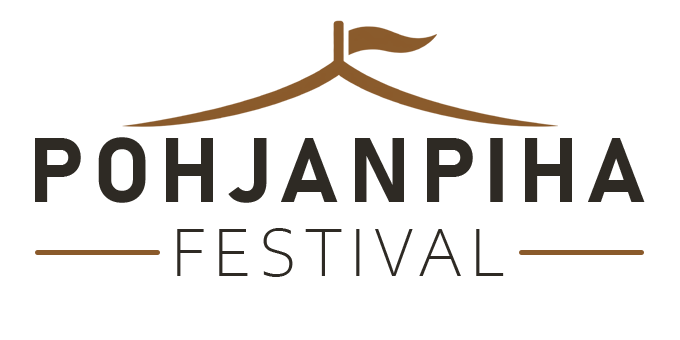

# Moodboard: Pohjanpiha Festival

## Tunnelma

Kolme sanaa: **lämmin, maanläheinen, vahva.**

- **Lämmin**, koska festivaali järjestetään heinäkuussa vanhalla talonpihalla järven rannalla. Lämmin beige ja ruskea tuovat mieleen kesäillan ja puun.
- **Maanläheinen**, koska paikka on vanha talonpiha eikä iso stadion. Ilmeen pitää olla aito, ei kiiltävä.
- **Vahva**, koska asiakas toivoi isoja ja vahvoja kirjaimia. Otsikot ovat isoja, lihavia ja versaaleja, ja ne erottuvat selvästi.

## Värit

| Nimi | Heksa | Käyttö |
|---|---|---|
| Tummanruskea | #2e2a24 | Teksti vaaleassa tilassa, reunat, tumman tilan tausta (hieman tummennettuna #1f1b16) |
| Vanha paperi | #f3ead8 | Tausta vaaleassa tilassa, teksti tummassa tilassa |
| Nahanruskea | #8a5a2b | Korostus: linkit, painikkeet, otsikoiden viivat |
| Vaalea nahanruskea | #d0a06a | Korostus tummassa tilassa |

Kontrastit (vaatimus 4,5 : 1):
- Leipäteksti taustalla vaaleassa tilassa: 11,9 : 1
- Korostus taustalla vaaleassa tilassa: 4,9 : 1
- Leipäteksti taustalla tummassa tilassa: 14,3 : 1
- Korostus taustalla tummassa tilassa: 7,3 : 1

Paletti on otettu asiakkaan antamista väreistä ja logosta. Logon tumma teksti ja ruskea korostus vastaavat samoja sävyjä.

## Fontit

| Käyttö | Fontti | Miksi |
|---|---|---|
| Otsikot | Arial Black (varalla Arial, sans-serif) | Iso ja vahva, kuten asiakas halusi. Järjestelmäfontti, joten ei latausaikaa. |
| Leipäteksti | Georgia (varalla Times New Roman, serif) | Tuo vanhan paperin tunnelmaa. |

Ulkoisia fontteja ei käytetä, koska asiakas halusi nopeat sivut. Heikolla kentällä ne hidastaisivat lataamista.